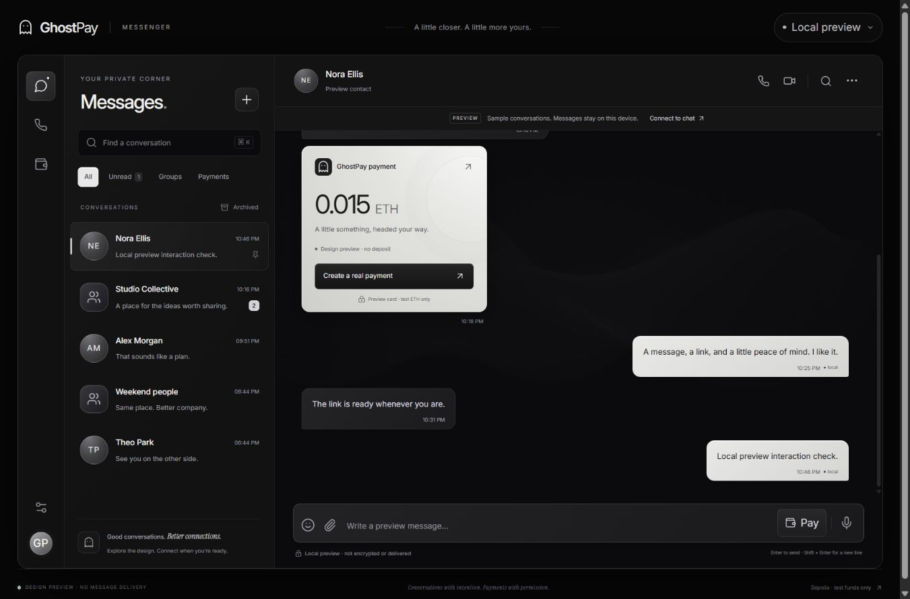
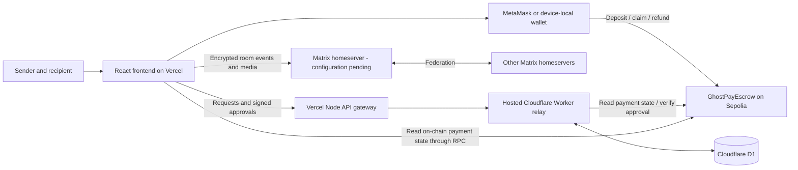

<div align="center">


# GhostPay

### Conversations with intention. Payments with permission.

A monochrome messenger built around Matrix and EVM native-coin payment links. Chat UI, encrypted-room integration, live USD reference estimates and sender-approved escrow share one interface.

[](https://ghostpay-lac.vercel.app)
[](https://sepolia.etherscan.io/address/0x3F5632eDFcbF22D7CFF126106854a6700Ffd7bF4)
[](#security-and-current-limits)

[Open messenger](https://ghostpay-lac.vercel.app/chat) · [View contract](https://sepolia.etherscan.io/address/0x3F5632eDFcbF22D7CFF126106854a6700Ffd7bF4) · [Run locally](#run-locally) · [Security](#security-and-current-limits)

</div>

> **EVM testnets only. Experimental and unaudited.** Use test coins. GhostPay is transparent escrow: wallets, amounts, approvals, and blockchain activity are not private.

## Messenger release

**[Explore the messenger](https://ghostpay-lac.vercel.app/chat).** The public release currently opens a clearly labeled **local preview**, with fictional conversations. Preview messages stay in your browser; nobody receives them. A Matrix homeserver and Google OIDC configuration have not been supplied or deployed.

| Area | Current behavior |
| --- | --- |
| Interface | Responsive inbox/thread layout, search and filters, groups, replies, local pin/mute/archive preferences, emoji picker, contact details and payment cards |
| Matrix integration | Real SDK adapter for login/SSO, sync, encrypted private rooms, invitations, typing, receipts, pagination and encrypted attachments; live delivery is awaiting a server and end-to-end verification |
| Payment links | Live USD reference entry, EVM testnet picker, native-coin escrow deployment and signed request/approval links; existing Sepolia links remain supported |
| Self-custodial wallet | Opt-in, client-generated Ethereum key; password-encrypted JSON backup, import, auto-lock and explicit signature/transaction confirmations; MetaMask remains available |
| Google login | Discovers the homeserver’s advertised provider; OAuth secrets belong on Synapse, never in the frontend. Google does not recover the wallet |
| Infrastructure | Synapse/PostgreSQL/Caddy configuration and setup guide prepared in [`infra/matrix`](infra/matrix/README.md); not started on this machine |
| Remaining | Live cross-device/federation verification, full device verification/key-backup interface, calls/push services, native mobile clients and broader WhatsApp feature parity |

The UI includes voice-note recording through the browser’s MediaRecorder API. Microphone capture and live encrypted media delivery still need testing with user permission and a configured server. Calling controls explicitly show that calls are not enabled.

See [`docs/MESSENGER.md`](docs/MESSENGER.md) for architecture, wallet boundaries and the activation checklist. This is a working UI and integration foundation, not a claim of complete WhatsApp parity or a production-audited messenger.



## Why GhostPay?

A direct wallet transfer requires the destination address upfront. A payment link makes sharing easier, but the person who opens it may not be the intended recipient.

GhostPay separates **discovering a payment** from **permission to withdraw it**. The URL contains a payment ID, not a secret withdrawal key. The sender approves a specific requesting wallet after independently verifying it, and the contract enforces that choice.

Payment links, escrow, and digital signatures already exist. GhostPay's focus is their combination into a deliberate **fund → request → verify → authorize → claim** workflow. This adds an approval step, so it suits payments where checking the recipient matters more than immediate redemption.

## EVM native payments

Open **[Create payment](https://ghostpay-lac.vercel.app/create)** or choose **Pay** inside a conversation. Select the EVM testnet and enter USD reference or a native-coin amount. Common choices include Sepolia ETH, BNB Smart Chain test BNB, Polygon Amoy POL, Avalanche Fuji AVAX, Base/Arbitrum/OP Sepolia ETH, Celo Sepolia CELO and Sonic test S. The searchable catalog contains **303 testnet definitions**, not 303 verified deployments or guaranteed working RPC endpoints. Mainnets, Bitcoin and TRON are excluded.

**One contract implementation, separate deployments.** [`GhostPayNativeEscrow.sol`](contracts/contracts/GhostPayNativeEscrow.sol) holds each network's native coin using the same Solidity source and Paris-targeted bytecode. It preserves fund-first, sender-approved-recipient claims and sender refunds after expiry. There is no bridge, token swap, ERC-20 support, administrative withdrawal or upgrade mechanism. A payment settles on the network where it was funded.

The only existing configured public escrow is the original Sepolia v1 address listed below. Other networks require **Deploy escrow** through the user's funded testnet MetaMask wallet, or import an existing deployment of the exact v2 runtime. The app checks RPC chain ID, deployed bytecode and signing domain before using it. The deployment transaction pays testnet gas; it is separate from the payment deposit. Deployment addresses are remembered on that browser; payment URLs include chain, contract and payment ID for other devices.

**Live rate estimates.** `/api/prices` fetches a fixed asset allowlist from CoinGecko, with Coinbase as a separately labeled fallback. Prices show their source and update/retrieval time, refresh every 45 seconds, and expire for conversion after three minutes. USD conversion uses integer arithmetic and rounds down to native base units. The native amount and rate are frozen once a deposit is submitted. Test coins have **no redeemable USD value**: these are corresponding mainnet market references, not fiat payments, swaps or price guarantees. Missing/stale prices require native amount entry. Optional `COINGECKO_DEMO_API_KEY` belongs on the server/Vercel environment, never in a `VITE_` variable.

**v2 signed-link workflow:**

1. The sender funds an escrow and shares `/pay/v2/<chainId>/<contract>/<paymentId>`.
2. The recipient signs a typed wallet request and sends the complete `#request=` link back.
3. The sender opens/pastes that link, independently verifies the person and full wallet address, and signs an authorization lasting at most 15 minutes (bounded by escrow expiry).
4. The sender shares the complete `#authorization=` link; the exact approved wallet submits the on-chain claim and pays that network's gas.
5. The sender can refund an unclaimed deposit after expiry. Approvals cannot be revoked before their deadline; the first valid claim wins.

v2 uses signed URL fragments instead of the legacy Sepolia relay. Keep the complete link when sharing. The same escrow contract validates the sender's authorization on each chain. The original `/pay/<id>` links and Worker/D1 relay continue to serve v1 Sepolia payments. The device-local wallet remains restricted to that original Sepolia contract; new EVM escrow flows use MetaMask. This release does not add wallet-key custody to the backend.

Known submitted hashes are retained while the current payment dialog/page remains open, so checking a pending transaction does not issue a second deposit. This is not durable pending-transaction recovery across reloads: save the explorer hash and funded link, and check the chain before starting again. The v2 history is device-local, not an indexer or a wallet backup. Public funded two-wallet lifecycle checks on additional networks require user-controlled funded wallets and have not been performed.

See [`docs/EVM-PAYMENTS.md`](docs/EVM-PAYMENTS.md) for setup, verification and protocol boundaries.

## Live deployment

| Resource | Details |
| --- | --- |
| **Vercel app** | **https://ghostpay-lac.vercel.app** |
| Network | Ethereum Sepolia |
| Chain ID | `11155111` |
| Asset | Native Sepolia ETH |
| Contract | [`0x3F5632eDFcbF22D7CFF126106854a6700Ffd7bF4`](https://sepolia.etherscan.io/address/0x3F5632eDFcbF22D7CFF126106854a6700Ffd7bF4) |
| Creation transaction | [`0x0c974214ff37b53d2d36a897ef785ea555ac18bd0f301ade5c7b6a6447d91f13`](https://sepolia.etherscan.io/tx/0x0c974214ff37b53d2d36a897ef785ea555ac18bd0f301ade5c7b6a6447d91f13) |
| Deployment block | `11932903` |
| Saved configuration | [`deployments/sepolia.json`](deployments/sepolia.json) |

The creation transaction was checked against the compiled contract bytecode, successful receipt, canonical block, confirmations, and deployed code. This deployment check is **not a security audit or a claim of Etherscan source-code verification**.

## How it works

1. **Create a payment.** Connect MetaMask or unlock your GhostPay wallet, choose an amount and expiry, and confirm the deposit transaction. The contract holds the ETH and emits the payment ID.
2. **Share the link.** Send the generated `/pay/<id>` URL to the intended recipient.
3. **Request a claim.** The recipient connects their wallet and signs a message proving wallet control. The relay records the request.
4. **Verify and approve.** The sender confirms the person and full wallet address through a trusted channel, then signs a wallet-bound EIP-712 authorization.
5. **Claim on-chain.** The approved recipient submits the authorization from that same wallet. The contract validates it and transfers the ETH once.
6. **Refund if unclaimed.** At or after payment expiry, the original sender can submit a refund transaction. Refunds are manual, not automatic.

| Action | On-chain transaction? | Network gas |
| --- | --- | --- |
| Create/fund payment | Yes | Sender pays |
| Request a claim | No; signed message | None |
| Approve or decline a request | No; signed message | None |
| Claim payment | Yes | Recipient pays |
| Refund expired payment | Yes | Sender pays |

There is no protocol fee in the current escrow contract. Ethereum network gas still applies.

## Implemented features

- **Fund before selecting a wallet:** deposit first; authorize the destination later.
- **Wallet-bound authorization:** approval covers the payment ID, recipient, deadline, chain, and escrow contract.
- **Recipient-only, one-time claims:** the caller must be the approved recipient, and completed payments cannot be claimed again.
- **Expiry and refunds:** unclaimed deposits become refundable by their original sender after expiry.
- **Request management:** view, approve, decline, and renew expired approvals while a payment remains active.
- **Shared, persistent hosted requests:** both public sites use the same Worker/D1 relay, with atomic version checks for concurrent decisions.
- **Wallet-based deployment setup:** deploy through MetaMask and verify the creation transaction without giving the relay a private key.
- **Public demo and responsive interface:** monochrome dashboard, payment pages, transaction explorer links, and a lazy-loaded Three.js particle background.

## Architecture



**On-chain:** escrow deposits, original sender, amount, expiry, and payment status. The contract determines whether funds can move.

**Off-chain:** claim requests, pending/authorized/rejected decisions, deadlines, and signatures. The hosted relay coordinates users; it has no signing key that authorizes withdrawals.

**Hosting:** Vercel serves the frontend and a same-origin API gateway. That gateway connects to the existing persistent Worker/D1 relay. The database has not been migrated into Vercel. The original [Sites deployment](https://ghostpay-prem-sepolia.brawnyfrost16.chatgpt.site) shares the same contract and request records.

**Local development:** Vite proxies `/api` to an Express relay. Local requests are stored in memory and are separate from hosted request records.

### Technology

| Layer | Stack |
| --- | --- |
| Frontend | React 19, TypeScript, Vite 7, Tailwind CSS 4, React Router |
| Wallet / chain client | MetaMask, wagmi, viem |
| Visuals | Three.js, Lucide, self-hosted Inter and Instrument Serif |
| Smart contract | Solidity 0.8.28; original v1 Cancun/OpenZeppelin 5.4; shared v2 native escrow targets Paris |
| Contract tooling | Hardhat 3 for compilation, isolated tests, and optional CLI deployment |
| Local relay | Node.js, Express 5 |
| Hosted relay / storage | Cloudflare Worker and D1 |
| Public frontend / gateway | Vercel, deployed using its CLI |

## Try the two-wallet demo

1. Open **https://ghostpay-lac.vercel.app** in two browser profiles or on two devices with MetaMask.
2. Switch both wallets to **Ethereum Sepolia** and obtain test ETH using an [Ethereum-listed faucet](https://ethereum.org/en/developers/docs/networks/#sepolia). The recipient needs test ETH for claim gas too.
3. As sender, create a small payment, such as `0.001 ETH`, with enough time to complete the demo.
4. Share the generated public link. As recipient, open it and select **Request to claim**.
5. As sender, independently verify the recipient's full address and select **Approve wallet**.
6. As recipient, select **Claim** and confirm the transaction. Check the resulting transaction on Sepolia Etherscan.

To demonstrate the authorization boundary, let a third wallet open the same link and request a claim without approving it. Possessing the URL alone does not authorize withdrawal. To demonstrate refunds, leave a separate short-lived payment unclaimed, wait for actual expiry, and refund as sender.

Use the hosted app on both devices. `localhost` and `127.0.0.1` identify the visitor's own computer; they are not shareable public payment URLs.

## Run locally

**Requirements:** Node.js 24 recommended (minimum 22.13), npm, MetaMask, internet access, and Sepolia test ETH for transactions.

```bash
git clone https://github.com/prembharne/GHostPay.git
cd GHostPay
npm ci
npm start
```

Open **http://localhost:5173**. `npm start` compiles the contract and launches the local relay and frontend. It does not start a local blockchain. The running app uses Sepolia; Hardhat's isolated test network is only for development tests.

The included public deployment record connects the local app to the same Sepolia escrow. It does **not** import hosted claim requests into the local relay. A payment link is meaningful for its configured chain and contract; use a consistent relay origin when coordinating approval.

### Configuration

The default public RPC needs no API key. Optional root `.env` settings:

```dotenv
SEPOLIA_RPC_URL=https://ethereum-sepolia-rpc.publicnode.com
FRONTEND_ORIGIN=http://localhost:5173,http://127.0.0.1:5173
```

See [`.env.example`](.env.example). A browser RPC override can be set as `VITE_RPC_URL` in `frontend/.env.local`. `VITE_` values are browser-visible; never place signing keys or secret API credentials there.

### Deploy your own Sepolia escrow

The public demo is already configured. To create a separate deployment, use a separate checkout and move its existing `deployments/sepolia.json` aside before starting the relay. Do not replace a deployment record that identifies deposits you still need to manage.

Open `/setup`, connect a funded Sepolia wallet, and confirm **Deploy on Sepolia** in MetaMask. Setup waits for two confirmations and verifies the creation transaction before saving the new manifest. The relay refuses replacing an already configured escrow.

An optional `npm run deploy` CLI flow is also available. It requires `SEPOLIA_PRIVATE_KEY` only in the deployer's own shell. The normal app and relay require no private key, and MetaMask is the recommended deployment flow.

### Commands

| Command | Purpose |
| --- | --- |
| `npm start` | Compile and launch the local Sepolia app |
| `npm run dev` | Run local relay and Vite; compile artifacts first |
| `npm run compile` | Compile the escrow |
| `npm run build` | Build contracts, local backend, and frontend |
| `npm test` | Run contract and local relay/deployment tests |
| `npm run test:messenger` | Validate payment cards, server URLs, encrypted vault and signing confirmations |
| `npm run sync:vercel` | Replace the Vercel asset snapshot from the completed frontend build |
| `npm run check:sepolia` | Check the live RPC and saved contract code |
| `npm run deploy` | Optional Sepolia contract deployment from the CLI |

Hosting-specific dependencies are separate from the root npm workspaces. See [`public-site/HOSTING.md`](public-site/HOSTING.md) and [`vercel-site/README.md`](vercel-site/README.md) for build and deployment details. Fresh deployments require your own authenticated hosting accounts.

## Contract interface

Source: [`contracts/contracts/GhostPayEscrow.sol`](contracts/contracts/GhostPayEscrow.sol)

```solidity
createETHPayment(uint256 expiry) payable returns (uint256 paymentId)
claimPayment(uint256 paymentId, address recipient, uint256 authorizationDeadline, bytes signature)
refundPayment(uint256 paymentId)
getPayment(uint256 paymentId) view returns (Payment)
```

The payment states are `None`, `Active`, `Claimed`, and `Refunded`. Request states such as `pending` and `rejected` belong to the relay; declining a request does not cancel or refund the on-chain payment.

## Relay API

All app requests use the same-origin `/api` prefix. Mutating claim routes require wallet signatures.

| Endpoint | Purpose |
| --- | --- |
| `GET /api/health` | Relay connectivity and live Sepolia head |
| `GET /api/deployment` | Configured escrow address and deployment record |
| `POST /api/requests` | Create a recipient-signed claim request |
| `GET /api/requests/payment/:paymentId` | List requests for a payment |
| `GET /api/requests/:id` | Read a request and any authorization |
| `POST /api/requests/:id/authorize` | Submit the sender's EIP-712 approval |
| `POST /api/requests/:id/reject` | Submit a sender-signed rejection |

The local setup relay additionally exposes `GET /api/deployment/artifact` and `POST /api/deployment`. Deployment changes are disabled on the public hosted relay.

## Tests and verification

The existing payment regression suites passed **48 automated tests**. The new messenger/wallet suite also passes (12 tests reported by Node, including its parent suite):

| Suite | Tests | Scope |
| --- | ---: | --- |
| Escrow contract | 22 | Deposits, authorization binding, replay, expiry, refunds, reentrancy, failed transfers |
| Local request relay | 9 | Wallet proofs and request/approval handling |
| Deployment registration | 8 | Creation-bytecode, receipt, network, confirmation, and replacement checks |
| Hosted Worker / storage adapter | 5 | Cross-instance records, isolation, concurrent updates, routing, signatures, payload bounds |
| Vercel API gateway | 4 | Fixed upstream, origin checks, request bounds, signature forwarding, upstream errors |

Run `npm test` at the root for the first three suites. For hosting checks:

```bash
cd public-site
npm ci
npm run build
npm test
npm run validate
cd ../vercel-site
npm test
```

Worker storage tests use an SQLite adapter; deployment-registration tests use mocked RPC responses. Public HTTP routes, assets, live Sepolia health, shared request reads, and invalid POST handling were checked separately. These checks are not an audit and do not establish a complete two-wallet MetaMask lifecycle. See [`STATUS.md`](STATUS.md) for the verification record.

## Security and current limits

- **Authorization:** EIP-712 binds the payment, exact recipient, deadline, chain, and contract. The caller must equal that recipient. Payment state prevents repeated claims.
- **Transfers:** OpenZeppelin `SignatureChecker`, `ReentrancyGuard`, and checks-effects-interactions are used. A failed ETH transfer reverts the state change.
- **No operator withdrawal key:** the contract has no administrator withdrawal function, upgrade mechanism, protocol fee, or tokenomics.
- **Identity remains a human check:** a signature proves wallet control, not a person's identity. Approving the wrong wallet can still lose funds.
- **Approval limits:** approvals currently cannot be revoked before their deadline. If multiple wallets are approved, the first valid claimant receives the entire payment.
- **Timing:** payment expiry is limited to 1 minute–30 days at creation. Claims stop at payment expiry. Dashboard approvals last at most 15 minutes, bounded by payment expiry.
- **Service trust:** the relay cannot forge sender authorization, but it can hide or delay requests. A compromised interface can mislead someone into signing; inspect wallet prompts and use trusted URLs.
- **Availability:** the public RPC and hosted relay can fail or rate-limit. Vercel gateway traffic shares upstream egress-IP quotas. Local relay records are lost on restart; hosted D1 records persist.
- **Scope:** ETH-only, Sepolia-only, no sponsored claim gas. On-chain payments and relay request records are public even when their chat message is encrypted. No dispute arbitration or reversal of completed transfers.
- **Device wallet:** browser JavaScript can access the key while unlocked. The wallet auto-locks after five minutes without a wallet operation; keep an encrypted backup and its password separately. Clearing browser data without a backup loses access. Google cannot recover it. This experimental wallet is restricted to the configured Sepolia escrow.
- **Messaging:** Matrix protects room content when configured correctly; servers can observe metadata. Preview mode is not encrypted or delivered. Full device verification and encrypted recovery setup remain unfinished.
- **Dependencies:** the root workspace audit currently retains 21 moderate findings after patching the reported high-severity transport issue. See [`STATUS.md`](STATUS.md); this is not a clean security audit.
- **Production readiness:** experimental and unaudited. Event indexing, broader wallet compatibility, operational hardening, and independent security review remain future work.

## Roadmap — proposals, not implemented

- [ ] Sender-sponsored claim gas for recipients with zero ETH.
- [ ] Contract-level approval revocation and safe replacement-wallet authorization.
- [x] Clear confirmation prompts in the device-local wallet.
- [ ] Verified Matrix-to-wallet identity binding and recipient verification fingerprints.
- [ ] A relay-independent rescue flow for existing signed approvals.
- [ ] Optional guardian approvals and explicit cancellation windows.
- [ ] Outcome-bound contributor bounties with a documented external-attestation trust model.

Some items require a new contract deployment and additional security testing. They are not features of the current public demo.

## Repository layout

```text
contracts/      Solidity escrow, Hardhat configuration, deployment script, tests
frontend/       Messenger, Matrix adapter, encrypted wallet, payment pages, Three.js scene
infra/matrix/   Self-hosted messaging and Google OIDC setup
docs/           Messenger architecture and activation guide
server/         Local Express relay and deployment verification
shared/         ABI, EIP-712 protocol, network constants, chain clock
deployments/    Public Sepolia deployment manifest
public-site/    Persistent Worker/D1 relay, migrations, production asset snapshot
vercel-site/    Vercel frontend snapshot, Node API gateway, deployment configuration
scripts/        Local launcher and read-only Sepolia check
STATUS.md       Recorded verification and remaining limits
```

## Acknowledgements

Built with Matrix, Synapse, OpenZeppelin, Ethereum, Hardhat, React, wagmi, viem, ethers, Three.js, Cloudflare, and Vercel. Self-hosted font license files are retained under [`frontend/public/licenses`](frontend/public/licenses).

Created by [Prem Bharne](https://github.com/prembharne).
