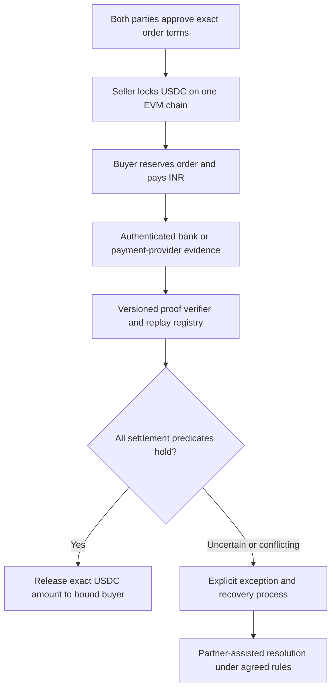

# INR ↔ USDC: can consensus make P2P trading safe?

Research date: 21 October 2026. This is an engineering assessment and proposed design, not a deployed feature, independent audit or legal opinion. GhostPay remains native-coin, EVM-testnet-only. No bank account was connected and no live INR/USDC trade was tested.

## Decision

**Build verifiable settlement on an existing EVM chain, rather than inventing a blockchain. Complete consensus-level safety for an off-chain INR payment cannot honestly be guaranteed.**

Consensus can make participants agree on which escrow transition is valid. It cannot independently establish whether a bank account was stolen, a payment was authorized, a later complaint is valid, or a bank will freeze an account. Seven validators inspecting the same misleading bank record can agree unanimously and still reach the wrong economic conclusion.

The strongest practical product combines USDC escrow, authenticated payment evidence, identity checks through an appropriate partner, narrowly defined settlement rules and a funded process for exceptions. Its promise should be **“release against verified evidence under disclosed rules,”** with remaining risks visible before either party pays.

## Three different meanings of finality

| Layer | What can be established | What it does not establish |
| --- | --- | --- |
| Blockchain | A sufficiently finalized transaction changed escrow state | Whether the INR came from an authorized payer |
| Payment evidence | An approved source reported a particular payment at a particular time | Permanent immunity from investigation, freeze or reversal |
| Economic/legal outcome | A partner's contractual obligations and applicable dispute process | A mathematical guarantee that neither party ever loses money |

This distinction is our inference from the trust boundaries, not a claim that every UPI payment is routinely reversible. Different rails, institutions and dispute grounds need separate analysis. A screenshot, SMS or user-entered UTR is not sufficient bank-origin proof.

## What already exists

**Peer, formerly ZKP2P, is a concrete integration candidate.** Its current Peer Cash documentation describes Base USDC cash-out and lists UPI/INR across production, preproduction and staging. Buyers pay and verify through Amazon Pay using standard UPI; UPI Lite and merchant payments are excluded. Sellers can receive at a valid UPI ID from any bank. The documented INR feeds are ZKP2P-operated AggregatorV3-compatible feeds, accessed through a Chainlink adapter; that name alone does not make the feed independently decentralized. Peer Cash is an off-ramp facade; the general SDK exposes maker/taker and proof workflows. These are maintainer claims, not our independent live-trade verification. Version-pin and verify the exact deployment, provider coverage, fees, availability and recovery rules before adoption. [Peer Cash primary documentation](https://github.com/zkp2p/peer-cash)

**zkTLS provides a useful building block.** DECO demonstrates proving that data originated at a TLS website, with selective disclosure. Our inference: authenticating a payment-status page is stronger evidence than a screenshot, but does not establish lawful ownership of the payer account or future legal finality. A specific production zkTLS/TEE implementation needs its own security and privacy review; the paper does not certify a vendor. [DECO paper](https://arxiv.org/abs/1909.00938)

**USDC has an issuer trust boundary.** Circle's token design includes pausing, address blacklisting and upgrade roles. An escrow cannot override those token controls; even a correct release can be blocked by issuer actions. [Circle token design](https://github.com/circlefin/stablecoin-evm/blob/master/doc/tokendesign.md)

## Architecture I recommend for GhostPay

This section is a proposed design, not a description of current code.

1. **Use one settlement chain initially.** Start with test USDC or a deliberately labeled mock token. Existing native-coin GhostPay contracts do not support ERC-20 USDC and must not be represented as doing so. A new ERC-20 escrow requires independent review, token-address verification, allowance limits and defensive accounting.
2. **Prefer a formal bank/payment-partner integration.** Require authenticated status, exact payee, currency, amount, provider transaction identifier and observation time. Prefer evidence of recipient credit where the rail supports it. Negotiate what that status actually guarantees and how fraud claims are handled.
3. **Treat zkTLS/TEE as an alternative evidence adapter.** Pin the provider origin, parser, verification circuit or attestor identity, policy version and allowed payment type. Reject unsupported providers, templates and ambiguous statuses. Do not place bank credentials or OTPs in GhostPay page code, logs, analytics or service-worker caches.
4. **Bind identity without pretending a wallet is KYC.** Google login, a wallet signature and a GhostPay username prove different things from control of a bank account. Use consent-based identity matching through the partner; reject third-party payment paths where the source data cannot establish the required relationship. Matching names alone does not defeat account takeover or money mules.
5. **Keep exception handling explicit.** Provider outages, late credits, partial payments and conflicting evidence must enter an exception state. A timeout is not proof that no money was paid. Automatic refunds after a timer can strand a buyer who paid before the deadline but whose proof arrived late.
6. **Bound exposure.** Start with capped orders, limited concurrent reservations and conservative supported rails. Collateral, holdbacks and insurance can absorb some losses only to the extent actually funded and contractually covered. An arbitrary holding period does not eliminate bank or legal risk.

## Would a validator committee help?

It can reduce dependence on one operator if the operators, keys and infrastructure are meaningfully independent. It cannot turn an untrusted input into a true bank fact.

PBFT's model uses at least `3f + 1` replicas and `2f + 1` responses to tolerate `f` Byzantine faults, with additional protocol and liveness assumptions. Seven replicas therefore illustrate a two-fault model and five-response quorum. **Collecting five signatures is not by itself a complete PBFT implementation or a guarantee of independent evidence.** [Original PBFT service properties](https://www.usenix.org/legacy/events/osdi99/full_papers/castro/castro_html/node3.html)

For GhostPay, Ethereum already orders escrow transitions. A separate committee, if justified, should attest narrowly defined external evidence. The proposed rules would require:

- A fixed, authenticated committee per epoch, distinct signers, threshold checks and explicit key rotation. No open “one wallet, one vote” membership.
- Every signature bound to the same canonical evidence statement and policy version. A relayer is replaceable and cannot change the payee or amount.
- At most one terminal outcome per order and one consumption per provider payment. Conflicting signed decisions are objectively detectable; bank fraud allegations generally are not.
- Independent evidence verification, not seven copies of one hosted oracle response. Correlated provider compromise remains a common failure mode.
- A documented response to unavailable quorum. “Fail closed” prevents an unsafe release but may lock funds, so liveness and recovery need their own design.

**Recommendation:** prototype the evidence verifier and order state machine first. Add a committee only after its benefit over direct proof verification and a partner-signed receipt is demonstrated. A custom consensus network adds operating, membership and security burdens without fixing the core bank-data boundary.

## Settlement statement and invariants

Proposed signed statement: application/version, chain ID, escrow address, order ID, approved USDC token and base-unit amount, INR amount in paise, exact crypto recipient, commitments to the fiat payer/payee, provider, payment type, parser/policy hash, payment nullifier, observed payment status/time, evidence expiry and committee epoch. Use a domain-separated encoding such as EIP-712; recheck the full domain on-chain.

The nullifier must derive from a canonical provider transaction identity in a way that cannot be regenerated with a fresh salt for the same payment. Where proof privacy is required, the circuit must enforce that derivation. A caller-supplied hash is insufficient.

Required properties for a future implementation:

- Escrow liabilities never exceed actual supported-token custody. Fees and refunds are included in the accounting.
- The same order cannot settle twice, and the same fiat payment cannot fund multiple orders.
- Recipient, currency, amount, chain, token, policy or order substitution invalidates the evidence.
- A cancellation/refund cannot race a valid reserved payment into two successful terminal transitions.
- Expired, pending, failed, wrong-payee, partial or unsupported payments cannot silently release funds.
- Emergency controls, if any, have narrowly bounded powers and an explicit effect on withdrawals; they must not be hidden behind “fully decentralized” branding.

**Cross-chain replay needs special care.** Putting a chain ID in the signature stops replaying that signature on another chain. It does not stop a second attestation for the same bank payment. Per-chain nullifier registries therefore do not suffice for multichain fiat settlement. Use a canonical consumption registry or a reviewed cross-chain coordination mechanism before expanding beyond one chain.

## Fraud and failure review

| Scenario | Proposed mitigation | Remaining limitation |
| --- | --- | --- |
| Fake screenshot or typed reference | Require authenticated, structurally verified source evidence | Compromised provider/parser can still lie |
| Stolen bank account or third-party payer | Partner identity and account-control checks; limit eligible rails | Valid-looking payments can still be unauthorized |
| Proof reused on two orders | Canonical payment nullifier consumed atomically | Multichain consumption requires coordination |
| Wrong recipient, currency or amount | Exact intent/evidence binding, integer amounts and user review | Bad source identity data is still a dependency |
| Colluding validators | Independent operators and bounded threshold assumption | Threshold compromise defeats the committee |
| One bank/source serves every validator | Model source as a shared dependency | More signatures do not diversify the source |
| Offline prover, bank outage or late credit | Reservation and explicit exception path | No guaranteed instant completion |
| Account freeze after USDC release | Partner process, documented limits and funded protection | Smart contracts cannot unfreeze bank accounts |
| USDC blocked or paused | Approved token monitoring and clear error/recovery states | GhostPay cannot override issuer controls |
| Order spam or liquidity griefing | Bounded reservations, expiry and proportionate admission rules | Admission rules introduce policy tradeoffs |

Do not slash someone for a disputed off-chain allegation without an agreed evidence and appeal process. Slashing invalid proofs or provable double-signing is a different, objectively checkable condition.

## Product and privacy requirements

Before an order starts, display which evidence source is trusted, which party receives INR/USDC, the exact locked rate and fees, deadlines, cancellation rules and what happens if a bank complaint arrives later. Show separate “payment reported,” “proof accepted” and “USDC released” states. Do not display a universal “100% safe” badge.

Keep raw bank statements, VPAs, names, credentials and sensitive evidence off-chain. A plain hash of a short identifier can be guessed; use a reviewed commitment scheme and access controls. A public chain leaks timing and amounts even when identifiers are hidden. Retention, access, breach handling and user consent are separate requirements from encryption.

INR exchange also requires India-specific legal and payment-partner review. FIU-India currently lists VDA AML/CFT guidelines updated 8 January 2026 and a registration circular revised 15 September 2025. This research does not determine GhostPay's legal classification or exemption; a “noncustodial” label is not a legal assessment. [FIU-India official downloads](https://fiuindia.gov.in/files/downloads/downloads.html)

## Practical next milestones

1. **Research prototype:** one testnet, mock INR proof source, mock/test USDC, explicit state diagram and measurable invariants. No real money or bank credentials.
2. **Adversarial validation:** replay across orders/chains, front-running, amount/identity substitution, false status, partial/late payment, orphaned evidence, stale parser, signer compromise, quorum outage, token failure, cancellation races and recovery after refresh. Add property-based accounting/state-machine tests and a reproducible threat model.
3. **Partner feasibility:** verify authenticated INR evidence availability, supported apps/payment types, lawful use, privacy controls, dispute responsibility and liquidity. Compare a pinned Peer integration against a formal partner adapter using the same failure cases. Neither is assumed safe from documentation alone.
4. **Independent review and constrained pilot:** review the contract, proof adapter, client, operational keys and recovery policy together. Approve mainnet separately, then use capped, monitored exposure with funded exception handling.

The useful differentiator is a clear, auditable link between an order, bank-origin evidence and escrow release—with honest recovery rules. A new consensus token or more validators is not a substitute for that link.
