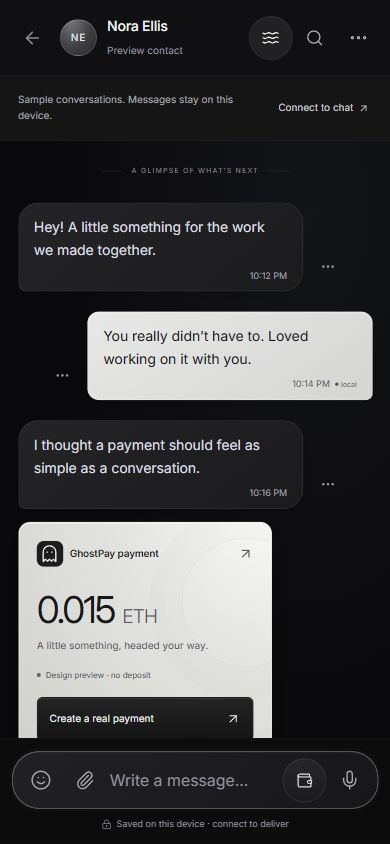
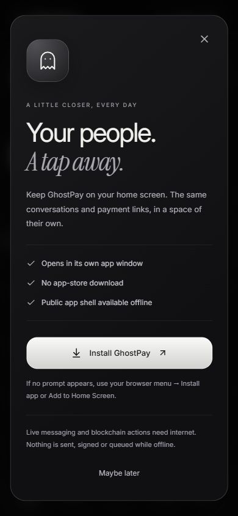

# GhostPay PWA

GhostPay remains a React/TypeScript web application. Its production build adds an installable manifest, public-code service worker, app icons and connection/update controls. There is no Flutter, Dart or native wrapper requirement.

## Install on a phone

Open [the messenger](https://ghostpay-lac.vercel.app/chat) over HTTPS. Tap **Install app** for instructions. Supporting Chromium browsers can offer an installation prompt; otherwise use the browser's **Install app / Add to Home Screen** menu. On iPhone/iPad, use Safari → Share → Add to Home Screen, and choose Open as Web App if offered. Availability depends on the browser and device. Installation does not connect a Matrix server or authorize a wallet.

The installed app launches `/chat`, uses the black/silver theme and includes Messages/Create payment shortcuts. App icons include 192px, maskable 512px and Apple 180px variants. `viewport-fit=cover` and safe-area CSS make room for device insets.

## What offline means

- The worker saves a fixed public application shell, local fonts, icons and required frontend chunks. The current precache is about 3.53 MiB before transport compression. It does not download all optional wallet, crypto or animation modules.
- Previously available local conversations may remain readable. Preview messages are fictional/on-device; this is not a claim of encrypted live delivery or a durable offline Matrix outbox.
- API, contract artifact, Matrix/auth, cross-origin RPC, non-GET, query-bearing and Authorization-bearing requests bypass the worker. Live navigation responses are not cached as user data.
- On a failed navigation fetch, `/` and `/chat` receive the fixed public shell; financial/setup routes receive a branded reconnect page. Already-open SPA screens can still be visible offline; a visible form does not imply a payment is available.
- The app displays an offline banner. Wallet preparation rejects offline use before requesting a provider, network switch, signature or transaction. Google wallet onboarding and username registration are disabled offline. No payment is queued or signed for later submission.

This cache policy is separate from existing device storage: local preview messages and explicitly enabled encrypted device-wallet backups have their own documented storage rules. The worker does not make those records private or recoverable.

## Updates and recovery

A new worker waits. The app offers an update reminder with a second, in-app confirmation explaining that unsaved payment details and message drafts will be lost. Only **Reload now** activates it and reloads this tab. Other tabs are not forcibly reloaded. The worker retains the immediately previous cache generation so older open tabs can continue using already cached chunks; it cannot promise every never-opened optional old chunk remains available after a hosting deployment.

Dialogs hide the update reminder while the current task is open. **Keep working** returns to the first reminder and dismissing the reminder leaves the current session alone. No background update should interrupt a signature prompt or trigger a new payment.

Chunk/render errors show a branded recovery screen with a reload action. Reloading never clears wallet backups, Matrix data or conversations automatically. Keep transaction hashes and payment links before reloading an unfinished financial flow; this release does not add durable transaction recovery.

## Mobile refinements

- Five labeled navigation destinations, stable active states, safe-area padding and a compact inbox.
- Rounded composer/forms, 16px editable text on phone layouts, larger primary controls and clearer metadata.
- Conversation-specific in-memory drafts (up to 50) during the open messenger session; no extra plaintext draft persistence. Changing messaging identity clears drafts. Refreshing/navigating away can discard them.
- Mobile Enter inserts a new line; the send button submits. Desktop retains Enter-to-send and Shift+Enter for a new line. Composition events are respected.
- Monochrome loading/error/install/update surfaces and reduced-motion fallbacks. The Three.js background remains decorative, optional and pausable.

## Build and verification

`npm run build -w frontend` emits `.vite/manifest.json`, `sw.js` and `pwa-build.json`. The custom build hook includes static imports and CSS for the main shell, messenger and wallet dialog host. `pwa-build.json` lists public precache paths, byte count and the content-derived version.

`npm run test:messenger` includes six PWA tests covering manifest/icons, sensitive-request exclusion, offline navigation fallback, uncached online navigation, explicit update activation/previous-cache retention and bounded runtime caching. The full frontend run reports 32 passing tests, including the parent vault suite.

After publishing, `npm run check:pwa` compares the deployment's worker and all listed public precache files against `frontend/dist`, checks manifest/worker headers and rejects HTML asset fallbacks. An optional HTTPS origin can be passed after `--`. This check does not claim device installation or financial settlement.

Production checks should include:

1. `/sw.js`: JavaScript, `Cache-Control: no-store`, `Service-Worker-Allowed: /`.
2. `/manifest.webmanifest`: manifest JSON, `Cache-Control: no-cache`.
3. Every listed precache resource returns the expected type and matches the built content.
4. Phone inbox, conversation, composer, dialogs, payment review, landscape and a short viewport. Test actual install/soft-keyboard behavior on physical Android/iOS before claiming device certification.
5. True offline app launch and financial-route reconnect fallback, then restore connectivity. Page-only DevTools offline emulation may leave the service worker's own network online; inspect response sources before calling that a full offline test.

The running verification record is in [STATUS.md](../STATUS.md). Live Matrix delivery still needs a homeserver; no PWA feature changes that requirement. INR/USDC settlement remains [research only](P2P-SAFETY-RESEARCH.md).

Verified production views:

References: [MDN installation guide](https://developer.mozilla.org/en-US/docs/Web/Progressive_web_apps/Guides/Making_PWAs_installable), [MDN offline behavior](https://developer.mozilla.org/en-US/docs/Web/Progressive_web_apps/Guides/Offline_and_background_operation).
